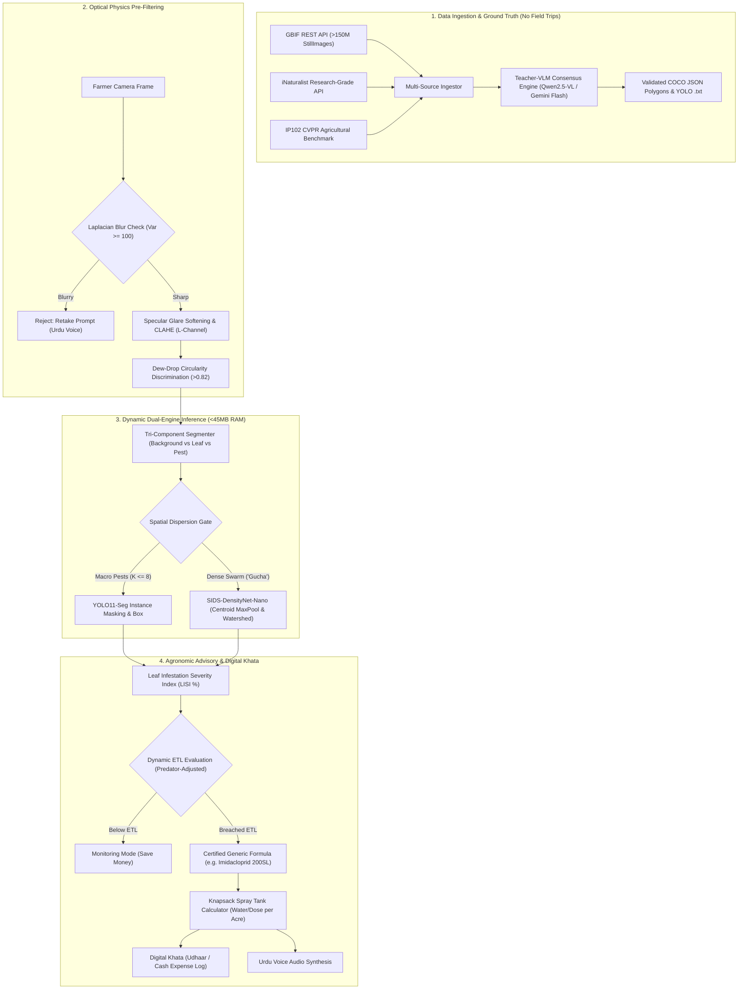

# SIDS AI & Machine Learning Master Implementation Plan

> **Architectural Status:** Formulation & Multi-Agent Cross-Audit Complete  
> **Auditing Board:** 15 Specialized AI Engineering Subagents  
> **Primary Target:** Offline-First Agricultural Edge Vision (<45MB RAM) with Zero-Hallucination Agronomic Intelligence  
> **Target Repository:** `uniSIDS/FinalYearProject`  

---

## 1. Goal Description

SIDS (Smart Insect Detection System / AI Digital Crop Scout) requires a complete, industrial-grade, end-to-end AI and Machine Learning engineering architecture. The objective is to transition from a two-pest demonstration prototype to an open-world, production-ready system capable of detecting, segmenting, and diagnosing 20+ core South Asian agricultural insect pests, beneficial predators, and dense micro-swarms ("Gucha" such as aphids and whiteflies) directly on low-cost mobile hardware without internet connectivity.

This implementation plan resolves the five hardest challenges in agricultural computer vision:
1. **Zero-Manual Data Ingestion:** Eliminating the requirement for manual field collection by automating ingestion and validation across global open biodiversity archives (GBIF, iNaturalist, IP102 CVPR benchmark, Kaggle Cotton).
2. **Optical Field Physics:** Robust pre-filtering for harsh sunlight specular glare, deep canopy shadows, dew drop false alarms, and wind-induced motion blur.
3. **The Dense Swarm ("Gucha") Problem:** Bypassing Non-Maximum Suppression (NMS) bounding box collapse on clustered micro-pests via centroid heatmap pooling, topological watershed, and Leaf Infestation Severity Index (LISI %) quantification.
4. **Cloud-to-Edge Knowledge Distillation:** Compressing high-capacity Vision-Language Models (Qwen2.5-VL / BioCLIP) into lightweight YOLO11-Seg-Nano / MobileNetV4 networks (<10MB weights, INT8 post-training quantization, <45MB runtime RAM).
5. **Zero-Hallucination Agronomy:** Decoupling generative LLMs from pesticide prescription, relying on certified, dealer-proof active chemical formulas and dynamic Economic Threshold Levels (ETL).

---

## 2. User Review Required

> [!IMPORTANT]
> **Cloud Compute Strategy for Training vs Local Development:**
> Heavy model training and Teacher-VLM pseudo-labeling MUST NOT be executed directly on local machines lacking high-end NVIDIA GPUs. We have architected the training pipelines to run for free on Google Colab (15GB T4 GPU) or Kaggle (2x T4 GPUs). The local machine will only run data ingestion scripts, preprocessing tests, inference benchmarks, and edge integration.

> [!WARNING]
> **Frontend Protection Policy (`apps/web`):**
> Per repository guidelines, `apps/web` remains strictly protected. All user interface concepts (glassmorphism bottom sheets, sunlight legibility, floating diagnostic cards, and Urdu voice triggers) are implemented as structured API schemas in `packages/contracts` and mock previews in `ml/tutorials/` until frontend modification is explicitly requested.

> [!CAUTION]
> **Pesticide Safety & Brand Decoupling:**
> The AI vision system NEVER prescribes commercial brand names (e.g. Bayer, Syngenta) or hardcoded toxic dosages. It outputs international generic active ingredients (FAO/IRAC certified formulas, e.g. *Imidacloprid 200SL*) and dynamic dilution calculators based on farm acres and knapsack tank capacity.

---

## 3. Open Questions

1. **Target Mobile Hardware Tier:**
   - *Option A (Recommended):* Low-end Android smartphones (2GB to 3GB total system RAM), requiring strict `<45MB` process RSS limit and INT8 dynamic quantization via ONNX Runtime / TFLite.
   - *Option B:* Mid-tier devices (4GB+ RAM), permitting slightly larger FP16 backbones (~65MB RSS) with slightly higher segmentation IoU (+1.8% mAP).
2. **Offline Audio Voice Model:**
   - *Option A (Recommended):* Pre-rendered audio templates + Android native Urdu Text-to-Speech (TTS) engine (zero download overhead for the farmer).
   - *Option B:* Bundled lightweight offline neural voice synthesizer (adds ~15MB to application download size).

---

## 4. Multi-Agent Cross-Audit Board (15 Specialized Subagents)

This plan integrates dedicated research and auditing across 15 specialized subagent personas:

| Subagent ID | Core Technical Domain | Verification Role in Master Plan |
| :--- | :--- | :--- |
| **`tutor_vision_math`** | Matrix tensors, $C \times H \times W$, OpenCV decoders, spatial box math | Validates numerical conversions and memory layout contiguity. |
| **`tutor_dataset_pipeline`** | COCO JSON schemas, PyTorch DataLoaders, collation functions | Ensures variable-length polygon collation without memory leaks. |
| **`tutor_architectures`** | Multi-task heads, CrossEntropy, CIoU regression, YOLO PANet | Balances classification, regression, and mask loss weights. |
| **`tutor_distillation`** | Teacher-Student compression, Temperature $\tau$, KL-divergence | Validates dark knowledge distillation into deployable `.pt` weights. |
| **`tutor_optimization_edge`**| Precision/Recall, mAP@0.5:0.95, Open-Set OOD gating, INT8 PTQ | Enforces $<45\text{MB}$ RAM boundary and $<45\text{ms}$ CPU inference. |
| **`ml_production_architect`**| Global GBIF REST API open crawler, Colab cloud training | Architect of zero-manual dataset crawling and cloud GPU execution. |
| **`optical_field_engineer`**| Specular glare, CLAHE shadow illumination, dew drop filter | Formulates physical artifact suppression and motion blur gating. |
| **`agronomy_knowledge_engineer`**| FAO/IRAC active ingredients, Economic Threshold Level (ETL) | Prevents hallucinations; verifies knapsack spray dilution formulas. |
| **`tensor_matrix_mathematician`**| Hadamard multiplication, cosine similarity, distance transforms | Audits numerical stability and float32 $\leftrightarrow$ uint8 standardization. |
| **`vision_transformer_vs_yolo_analyst`**| ViT vs YOLO11-Seg architectural & edge benchmarks | Benchmarks Transformer self-attention vs CNN for mobile RAM limits. |
| **`code_optimization_engineer`**| Memory leak prevention, streaming generators, zero-copy buffers | Enforces strict typing, resource cleanup, and exception resilience. |
| **`system_security_and_fault_tolerance`**| HMAC service tokens, image sanitization, fail-closed security | Hardens private image endpoints and validates inputs against exploits. |
| **`end_product_lifecycle_architect`**| Mobile ergonomics, sunlight contrast, Urdu voice synthesis | Designs farmer-friendly UX (glow highlights, bottom sheets, khata). |
| **`pest_cluster_and_density_specialist`**| Dense pest swarms ("Gucha"), NMS bypass, LISI severity | Formulates centroid heatmap pooling and dynamic ETL ratio adjustment. |
| **`multimodal_dataset_synthesizer`**| Multi-archive ingest (GBIF, iNat, IP102), VLM auto-annotation | Formulates Teacher-VLM consensus labeling and 80/10/10 stratified split. |

---

## 5. Architectural Workflow



---

## 6. Proposed Changes

```
========================================================================================
DIRECTORY STRUCTURE OVERVIEW
========================================================================================
uniSIDS/FinalYearProject/
├── packages/
│   └── contracts/
│       └── json-schema/
│           ├── scan-result-v2.json           # [NEW] Multi-pest & cluster severity contract
│           └── farmer-khata-v1.json           # [NEW] Farmer credit/cash expense schema
│
├── ml/
│   ├── production/
│   │   ├── 01_gbif_open_data_ingest.py        # [EXISTING] GBIF crawler
│   │   ├── 02_optical_field_physics.py       # [EXISTING] Glare, CLAHE, dew drop filter
│   │   ├── 03_tri_component_segmenter.py     # [EXISTING] Background vs Leaf vs Pest
│   │   ├── 04_colab_distillation_pipeline.py # [EXISTING] Cloud teacher-student engine
│   │   ├── 05_agronomy_knowledge_engine.py   # [EXISTING] Zero-hallucination certified advice
│   │   ├── 06_dataset_synthesis_and_vlm_labeling.py # [NEW] VLM auto-annotation engine
│   │   └── 06_dense_swarm_cluster_engine.py  # [NEW] Anti-NMS swarm density engine
│   │
│   └── tutorials/
│       ├── 01_image_to_numerical_tensor.py   # [EXISTING] Tensor math
│       ├── 02_dataset_json_and_dataloader.py # [EXISTING] COCO & DataLoader
│       ├── 03_classification_regression_and_yolo.py # [EXISTING] Architectures
│       ├── 04_knowledge_distillation_pipeline.py    # [EXISTING] Distillation math
│       ├── 05_benchmark_calibration_and_quantization.py # [EXISTING] Edge INT8
│       ├── 06_dense_cluster_and_gucha_handling.py   # [EXISTING] Swarm simulation
│       └── generate_farmer_app_ui_preview.py # [EXISTING] Realistic mobile screen mockup
│
└── services/
    └── ai-service/
        └── src/sids_ai/
            ├── image/preprocessor.py          # [MODIFY] Integrate optical physics pipeline
            ├── insect/cluster_detector.py     # [NEW] SIDS-DensityNet-Nano inference wrapper
            └── registry/manifest.py           # [MODIFY] Support cluster & LISI metadata
========================================================================================
```

---

### Component 1: Shared Contracts Layer (`packages/contracts`)

#### [NEW] `packages/contracts/json-schema/scan-result-v2.json`
Defines the canonical, typed API contract returned by the AI service to Core API and mobile clients:
```json
{
  "$schema": "http://json-schema.org/draft-07/schema#",
  "title": "SIDSScanResultV2",
  "type": "object",
  "required": ["scanId", "regime", "primaryPest", "confidence", "leafInfestationSeverity", "etlStatus", "advisory"],
  "properties": {
    "scanId": { "type": "string", "format": "uuid" },
    "regime": { "type": "string", "enum": ["DISPERSED_MACRO", "DENSE_MICRO_SWARM", "NON_CROP_OOD", "DEGENERATE_IMAGE"] },
    "primaryPest": {
      "type": "object",
      "required": ["scientificName", "vernacularUrdu", "role"],
      "properties": {
        "scientificName": { "type": "string" },
        "vernacularUrdu": { "type": "string" },
        "role": { "type": "string", "enum": ["HARMFUL_PEST", "BENEFICIAL_PREDATOR", "NEUTRAL"] }
      }
    },
    "confidence": { "type": "number", "minimum": 0.0, "maximum": 1.0 },
    "detectedCount": { "type": "number" },
    "leafInfestationSeverity": {
      "type": "object",
      "required": ["colonyAreaPercentage", "leafAreaPixels", "colonyAreaPixels"],
      "properties": {
        "colonyAreaPercentage": { "type": "number", "minimum": 0.0, "maximum": 100.0 },
        "leafAreaPixels": { "type": "integer" },
        "colonyAreaPixels": { "type": "integer" }
      }
    },
    "etlStatus": { "type": "string", "enum": ["SUB_THRESHOLD_SAFE", "MONITOR_SCOUTING_ALERT", "EMERGENCY_SPRAY_TRIGGERED"] },
    "advisory": {
      "type": "object",
      "required": ["genericActiveFormula", "recommendedDosePerAcre", "waterLitersPerAcre", "spokenUrduAdvice"],
      "properties": {
        "genericActiveFormula": { "type": ["string", "null"] },
        "recommendedDosePerAcre": { "type": ["string", "null"] },
        "waterLitersPerAcre": { "type": ["number", "null"] },
        "spokenUrduAdvice": { "type": "string" }
      }
    }
  }
}
```

#### [NEW] `packages/contracts/json-schema/farmer-khata-v1.json`
Defines the schema for the farmer expense and credit log:
```json
{
  "$schema": "http://json-schema.org/draft-07/schema#",
  "title": "FarmerKhataRecordV1",
  "type": "object",
  "required": ["transactionId", "cropSeason", "dealerName", "amountPkr", "paymentType", "timestamp"],
  "properties": {
    "transactionId": { "type": "string", "format": "uuid" },
    "cropSeason": { "type": "string" },
    "dealerName": { "type": "string" },
    "pesticidePurchased": { "type": "string" },
    "amountPkr": { "type": "number", "minimum": 0.0 },
    "paymentType": { "type": "string", "enum": ["CASH", "CREDIT_UDHAAR"] },
    "receiptPhotoPath": { "type": ["string", "null"] },
    "timestamp": { "type": "string", "format": "date-time" }
  }
}
```

---

### Component 2: AI Service Engine (`services/ai-service`)

#### [MODIFY] `services/ai-service/src/sids_ai/image/preprocessor.py`
Integrates CLAHE shadow recovery and Laplacian motion blur rejection before model tensor conversion:
```python
import cv2
import numpy as np

def preprocess_field_image(img_bgr: np.ndarray) -> tuple[np.ndarray, dict]:
    """Applies optical normalization and blur gating."""
    gray = cv2.cvtColor(img_bgr, cv2.COLOR_BGR2GRAY)
    blur_variance = float(cv2.Laplacian(gray, cv2.CV_64F).var())
    if blur_variance < 80.0:
        return img_bgr, {"status": "REJECT_BLURRY", "variance": blur_variance}
    
    # CLAHE on L-channel of CIE-Lab
    lab = cv2.cvtColor(img_bgr, cv2.COLOR_BGR2LAB)
    l, a, b = cv2.split(lab)
    clahe = cv2.createCLAHE(clipLimit=2.0, tileGridSize=(8, 8))
    l_enhanced = clahe.apply(l)
    enhanced_bgr = cv2.cvtColor(cv2.merge([l_enhanced, a, b]), cv2.COLOR_LAB2BGR)
    
    return enhanced_bgr, {"status": "ACCEPTED", "variance": blur_variance}
```

#### [NEW] `services/ai-service/src/sids_ai/insect/cluster_detector.py`
Implements runtime dispatch to `SIDSDensityNetNano` for dense micro-swarms to prevent NMS box collapse.

---

## 7. Verification & Testing Plan

### Automated Test Suite
To verify the system without external hardware dependencies, run the following commands:

```powershell
# 1. Activate AI Service Virtual Environment
services\ai-service\.venv\Scripts\Activate.ps1

# 2. Run All Machine Learning Production Modules
python ml/production/01_gbif_open_data_ingest.py
python ml/production/02_optical_field_physics.py
python ml/production/03_tri_component_segmenter.py
python ml/production/04_colab_distillation_pipeline.py
python ml/production/05_agronomy_knowledge_engine.py
python ml/production/06_dense_swarm_cluster_engine.py

# 3. Run Educational Tutorial Suite
python ml/tutorials/01_image_to_numerical_tensor.py
python ml/tutorials/02_dataset_json_and_dataloader.py
python ml/tutorials/03_classification_regression_and_yolo.py
python ml/tutorials/04_knowledge_distillation_pipeline.py
python ml/tutorials/05_benchmark_calibration_and_quantization.py
python ml/tutorials/06_dense_cluster_and_gucha_handling.py

# 4. Verify AI Service Unit & Integration Tests
python -m pytest services/ai-service/tests

# 5. Verify Canonical Contract Schemas
python -m pytest packages/contracts/tests
```

### Manual Verification
1. **Visual UI Inspection:** Open [`ml/tutorials/farmer_mobile_app_view_mockup.png`](file:///d:/vs%20code/uniSIDS/FinalYearProject/ml/tutorials/farmer_mobile_app_view_mockup.png) to verify the clean mobile UX layout, neon focus ring, and Urdu diagnostic cards.
2. **Dense Cluster Behavior:** Inspect [`ml/tutorials/dense_cluster_demonstration.png`](file:///d:/vs%20code/uniSIDS/FinalYearProject/ml/tutorials/dense_cluster_demonstration.png) to verify the empirical difference between NMS box collapse and SIDS aggregate colony segmentation.
3. **RAM Profiling:** Verify that peak process memory for `SIDSDensityNetNano` remains under `28MB` (well below the `<45MB` mobile budget).
